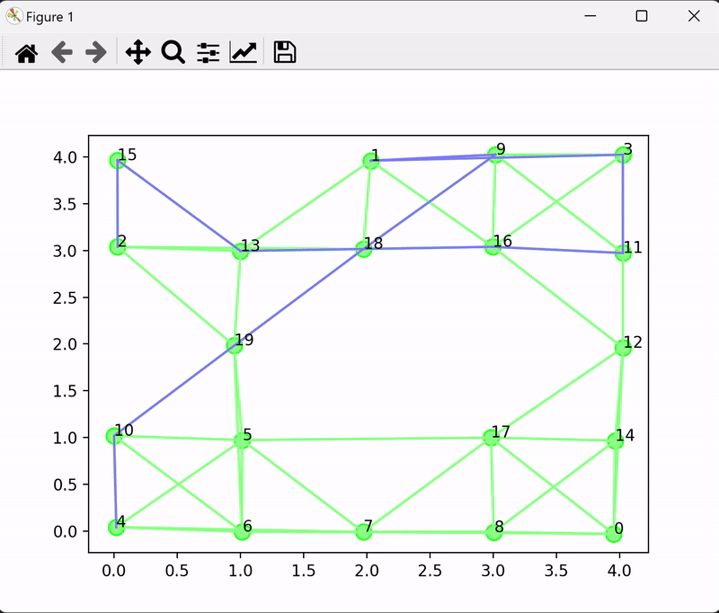

# Direction Based-Improved Ant Based Routing Algorithm (DB-IABR)

Python simulations for an energy-aware routing protocol for wireless sensor networks, built on ant colony optimisation. The code compares three protocols on the same random network: ant-based routing (ABR), improved ant-based routing (IABR) and the proposed direction-based IABR (DB-IABR).



**Published:** IEEE conference paper, 2022 International Conference on Industry 4.0 Technology (I4Tech), pp. 1–6. DOI: [10.1109/I4Tech55392.2022.9952718](https://doi.org/10.1109/I4Tech55392.2022.9952718). The paper PDF is in this repository.

## Why it is interesting

- Ants pick their next hop with a probability built from the pheromone on the link, the node's remaining energy and, in DB-IABR, a direction term that grows as the node gets closer to the sink (`Code/dbiabr.py`). This steers packets towards the sink without a global routing table.
- On the way back, ABR sets the pheromone it deposits from the path's hop count and length; IABR and DB-IABR also use the average and minimum remaining energy of the nodes on the path, so energy is part of what makes a route attractive.

## Run it

```bash
pip install -r requirements.txt
cd Code
python main.py               # runs ABR, IABR and DB-IABR on the same network and prints the metrics
cd Simulations
python DBIABR.py             # animated view of one protocol; ABR.py and IABR.py likewise
```

`main.py` reports, for each protocol, the network lifetime (successful packets), failed attempts, average path hops, path length, time and energy per packet. Network and energy parameters are in `Code/params.py`. The `.ipynb` files in `Code/Simulations/` are notebook versions of the same simulations.

## Tech

Python, NumPy, Matplotlib.

## Context

Research project at VIT Vellore, School of Computer Science and Engineering, 2022. The full author list is in the citation below.

## Cite

```bibtex
@inproceedings{Kanshi2022DBIABR,
  title     = {Direction Based-Improved Ant Based Routing Algorithm},
  author    = {Kanshi, Avaneesh and Melarkode, Navneet Vinod and Agarwal, Varun Niraj},
  booktitle = {2022 International Conference on Industry 4.0 Technology (I4Tech)},
  publisher = {IEEE},
  year      = {2022},
  pages     = {1--6},
  doi       = {10.1109/I4Tech55392.2022.9952718}
}
```

GitHub also reads `CITATION.cff` and shows a "Cite this repository" button.

## License

MIT, see LICENSE.
