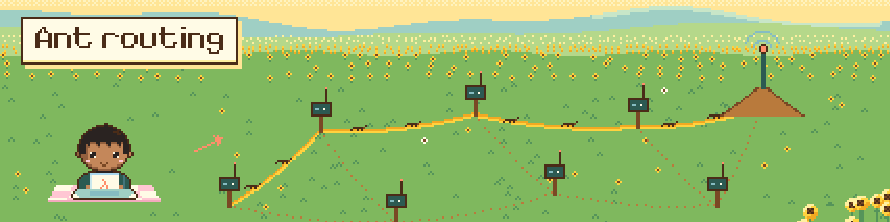

<p align="center"></p>

# Ant routing

Ant colony routing for wireless sensor networks, comparing ABR, IABR and DB-IABR (IEEE I4Tech 2022 paper, [DOI](https://doi.org/10.1109/I4Tech55392.2022.9952718)).


## Run it

```bash
pip install -r requirements.txt
cd Code
python main.py                     # runs the three protocols on one network and prints the metrics
cd Simulations && python DBIABR.py # animated view; ABR.py and IABR.py likewise
```

How the protocols work and what `main.py` reports: [docs/about.md](docs/about.md).

## Build and test

```bash
make check    # compiles the code and checks the notebooks; CI runs it
```

Cite it with `CITATION.cff` ("Cite this repository" on GitHub). Finished; see [STATUS.md](STATUS.md). MIT licence.
